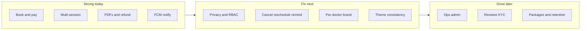

# PhysioConnect Product Enhancement Roadmap

## Verdict

You already have a **real, shippable core**: OTP login, city/area coverage booking, multi-session scheduling, Razorpay + platform fee split, doctor ops (status, notes, PDF Rx/invoice/letterhead, refund, callback ping). That is more than most early healthcare MVPs.

What holds it back from feeling like a polished **product** (vs a working tool) is not missing “50 features”—it is **trust gaps, unfinished patient actions, role/branding that still assume one doctor, and a design system that exists but is only half applied.**

---

## What you built well (keep)

- Clear booking funnel: City → Area → Doctor → Session → Date/time → Pay → Confirm
- Multi-session / bulk booking with address + GPS awareness
- Payment lifecycle with pending booking → Razorpay → verify
- Doctor toolkit that matches real clinic ops (status, notes, letterhead, Rx, invoice, refund)
- Thoughtful healthcare palette in [`lib/utils/theme/app_colors.dart`](lib/utils/theme/app_colors.dart) (sky blue / wellness green / therapy purple)
- Reusable pieces: [`CustomButton`](lib/custom_widget/custom_button.dart), [`CustomTextField`](lib/custom_widget/custom_text_field.dart), [`PhysioConnectLogo`](lib/custom_widget/physio_connect_logo.dart)

---

## Phase 0 — Trust and safety (do before more features)

These are product-critical, not “nice polish.”

1. **Doctor booking privacy**  
   In [`getFilteredBookings`](lib/supabase/supabase_controller.dart), the doctor filter is commented out, so doctors can see **all** bookings in a date range. Re-enable `.eq(bookingsDoctorId, userId)` and enforce the same with Supabase RLS.

2. **Real role model**  
   Doctor access is a hardcoded list (`DOCTOR_USER_ID_LIST = [3, 8, 65]` in [`constants.dart`](lib/utils/constants.dart)). Switch to `users.userType` (and server-side checks). Hardcoded IDs will break every new doctor onboarding.

3. **Remove / gate certificate bypass**  
   [`MyHttpOverrides`](lib/main.dart) accepts all TLS certs and is set globally—unsafe for a Play Store health app. Remove for release builds.

4. **Fake trust signals**  
   Profile shows **"86% Rating"** ([`profile_about_us_screen.dart`](lib/ui/profile/profile_about_us_screen.dart)) without real data. Either wire real ratings or remove until you have them—fake social proof damages medical trust.

5. **Per-doctor clinical identity on PDFs**  
   Letterhead / invoice / Rx still lean on **"Dr. Parul Desai"** defaults ([`letter_head_service.dart`](lib/services/letter_head_service.dart), [`invoice_service.dart`](lib/services/invoice_service.dart), prescription defaults). For multi-doctor cities, every PDF must use the assigned doctor’s name, registration number, and clinic details.

6. **Role-gate refunds and clinical actions**  
   Ensure refund / status / notes are doctor-only (and ideally server-authorized), not only hidden in UI.

---

## Phase 1 — Complete the patient journey (highest UX ROI)

Patients already expect these because the UI hints at them:

| Gap | Current state | Recommendation |
|-----|---------------|----------------|
| Reschedule / View details on home | Buttons are empty stubs in [`dashboard_screen.dart`](lib/ui/dashboard/dashboard_screen.dart) | Wire to booking detail; patient reschedule with slot re-pick + policy |
| Cancel booking | Doctor can set cancelled; patient cannot self-serve | Patient cancel + clear refund rules (e.g. free cancel >24h, partial after) |
| Appointment reminders | TODO noted in splash; only ad-hoc callback push | Scheduled FCM: confirm, T−24h, T−1h |
| Empty 4th patient tab | `Container()` in bottom nav | Remove tab or replace with Help / Support / Tips |
| Doctor lands on patient Home | Same shell for both roles | Doctor default tab = their appointments; hide or demote “Book like a patient” unless intentional |
| Profile | About + logout only | Edit name, saved addresses, notification prefs |

Also add a short **payment policy** on the summary screen: what happens if doctor cancels, no-show, or patient cancels—this reduces support load and Razorpay disputes.

---

## Phase 2 — Design system and brand polish

You already designed a theme; it is largely unused.

**Wire the system**
- Apply `theme: AppTheme.lightTheme` on `GetMaterialApp` in [`main.dart`](lib/main.dart) (currently missing).
- Prefer `Theme.of(context).textTheme` over ad-hoc `GoogleFonts.inter(...)` on every screen.
- Use `CustomButton` / theme buttons on booking, payment, history—not only login/prescription.

**Typography**
- Body: Inter is fine for healthcare apps (readable, neutral).
- App bar: **Fugaz One** ([`common_appbar.dart`](lib/utils/common_appbar.dart)) feels playful next to clinical Inter; either keep Fugaz only for splash/logo wordmark, or switch app bars to Inter w600 for a more clinical product feel.
- Contrast: black icons/text on bright blue→green gradient is weak; prefer white/near-white on the gradient.

**Spacing and cards**
- Introduce simple tokens (`8 / 16 / 24` spacing, `8 / 12 / 16` radii) so city/area/session/payment feel like one product.
- Fix copy bugs: **"ProFile & About Us"**, history titled **"Booking Details"**, brand **"Physio Connect"** vs **"PhysioConnect"**.

**Brand assets**
- [`AppImages`](lib/utils/image.dart) still points at `washing_walle_*` leftovers—clean to PhysioConnect assets only.
- One logo source of truth (painted logo vs `app_icon.png`) so login, splash, and PDFs match Play Store icon.

**Accessibility (physio audience skews older)**
- Larger tap targets, 16sp+ body on booking steps, avoid 10px breadcrumbs, optional Gujarati/Hindi later.

---

## Phase 3 — Doctor product (ops that scale)

- Doctor dashboard stats (currently commented) — today’s sessions, pending confirms, earnings this week
- Slot management UI (add/block times) instead of only DB CSV fields
- WhatsApp / call patient from booking card (TODO exists)
- Earnings / settlement view (85% after 2 working days, transfer status)—doctors will ask for this constantly
- Onboarding checklist: profile photo, registration no., Razorpay Route account, service areas, session types

---

## Phase 4 — Platform growth and monetization

Your 15% platform fee model is sound for home-visit physio. Strengthen it with product, not just settlement:

- **Lightweight admin** (even a simple web/Supabase dashboard): publish cities/areas/doctors, pause coverage, handle disputes—today this is SQL-only ([`supabase/README.md`](supabase/README.md))
- **Transparent fee line** on invoice for doctors (platform fee vs doctor amount); patients usually see session price only (keep it simple for them)
- **Packages / care plans** (e.g. 6-session back-pain pack) — natural upsell on multi-session you already support
- **Real ratings after completed session** (1–5 + short comment; show on doctor card)
- **Referral / share** (“book physio at home”) for city expansion
- **Analytics + Crashlytics** — you cannot improve retention without funnels (book started → paid → completed)
- **Support channel** in-app (WhatsApp business / email ticket)—callback-only is thin for payments/refunds
- Online/video sessions later (already noted as future in coverage docs)

---

## Suggested priority order (next 4–6 weeks)

1. Uncomment doctor booking filter + RLS + `userType` roles  
2. Wire dashboard Reschedule / View Details; patient cancel + refund policy copy  
3. Per-doctor PDF identity; remove fake 86% rating; kill TLS override in release  
4. Apply `AppTheme`, unify fonts/app bar contrast, fix titles/brand assets  
5. Session reminders (T−24h / T−1h)  
6. Doctor earnings strip + admin coverage tooling  
7. Ratings + packages when retention data justifies it  

---

## Out of scope for early phases (unless strategy changes)

- Full telehealth platform, insurance claims, multi-language CMS, dark mode polish, chat SDK  
- Building a second separate Doctor APK before fixing shared RBAC/privacy in this app  

---

## Default next step after you approve

Implement **Phase 0 + Phase 1 stubs** first (privacy filter, roles, wire home CTAs, cancel policy UX, theme wiring)—highest love-to-impact for patients and doctors already on Play Store.